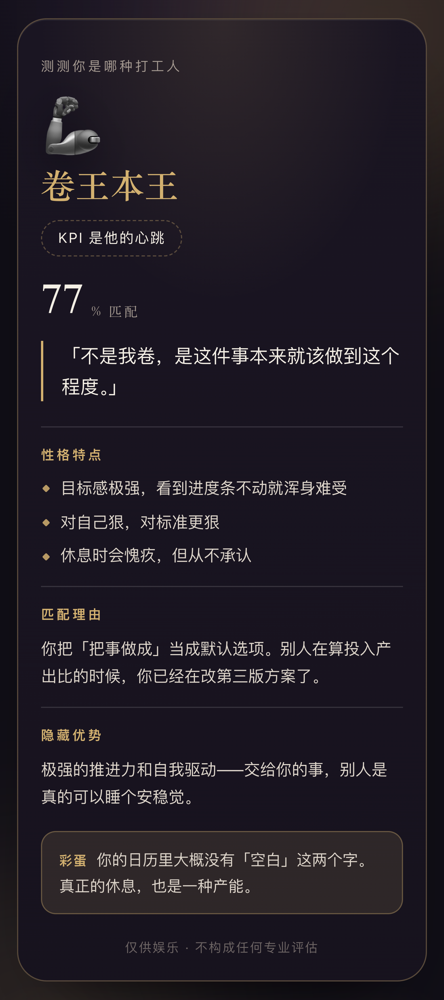
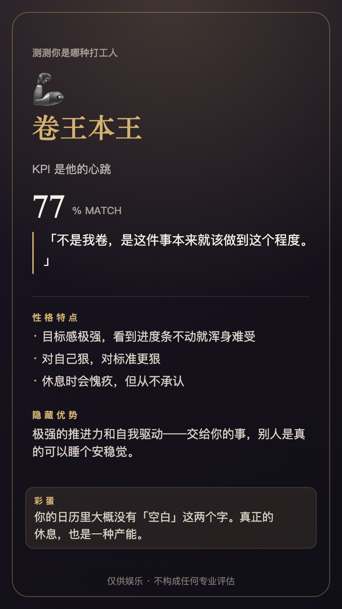

# 趣味测试网页生成器 · Quiz Webpage Generator

> 一个单文件、零依赖、数据驱动的人格测试网页引擎。换一份题库 JSON，就是一个新产品。



<p align="center">
  
</p>

<p align="center">
  
  
  
  
</p>

---

## 1. 这个项目解决什么问题

做「测测你是哪种打工人 / 你的灵魂老家在哪座城市」这类趣味测试，真正重复的工作不是想题目，而是**每换一个主题就要重写一遍前端**：题目渲染、进度条、翻页、评分、结果页排版、分享图，一样不少。

这个项目把这件事拆成两层：

- **引擎固定**：一个 42KB 的 HTML 文件，包含完整的答题流程、评分逻辑、结果卡片和海报导出，无后端、无框架、无 CDN。
- **题库是数据**：题目、结果类型、配色都放在页面内的一个 JSON 块里。换主题 = 替换这个 JSON，页面代码一个字都不用改。

同时它顺手解决了这类产品最常见的三个坑：

| 坑 | 表现 | 本项目的做法 |
| --- | --- | --- |
| 评分失衡 | 随便测，60% 的人都是同一类结果 | 附带校验脚本，模拟 8000 次随机作答，检查每个结果命中率是否落在 8%–25% |
| 没有分享动力 | 结果页好看但截不了图、发出去没人点 | 结果卡片为截图设计，另可一键导出 720×1280 PNG 海报、复制文案 |
| 国内打不开 | 用了在线字体/图标/CDN，微信里白屏 | 全内联，无任何外部请求，`file://` 双击即玩 |

适用场景：小红书/朋友圈趣味测试、公众号引流落地页、活动报名前的破冰小测试、社群互动、个人 IP 的自制小工具。

---

## 2. 主要功能

### 页面能力

- **完整流程**：首页 → 逐题作答 → 自动评分 → 结果页 → 重新测试
- **答题体验**：单选即切下一题、进度条与百分比、上一题回退、键盘 A/B/C/D 或 1–4 操作
- **结果页**：结果名称、专属标签、匹配度、金句、3 条性格特点、匹配理由、隐藏优势、彩蛋
- **分享导出**：Canvas 绘制 720×1280 海报（可下载 PNG）、一键复制结果文案（非 https 环境自动降级）
- **响应式**：390px 手机宽度与桌面都正常，无横向滚动
- **无外部依赖**：不加载任何字体、图片、脚本、统计代码

### 内容与质量

- **6 套主题配色**：国风金、奶油治愈、樱花粉、赛博霓虹、午夜蓝、复古报纸，浅色/深色都完整支持
- **两套可直接玩的示例**：打工人人格（深色）、小动物人格（浅色）
- **校验脚本**：结构检查（缺字段、权重引用错）、死类型检查（某结果永远测不出来）、随机分布模拟、并列率统计
- **文档**：选题库（5 大类 + 小众方向）、部署与上架变现清单

### 评分机制

- 每题 4 个选项，每个选项给 1–2 个结果类型加权（主类型 2 分，可加次类型 1 分）
- 总分最高者胜出；并列时看最近 6 题的倾向；仍并列按 `results` 顺序
- 匹配度按领先幅度计算（72%–99%），是展示值，不是概率

---

## 3. 安装方法

**运行时零依赖**：拿到 HTML 就能用。只有校验脚本需要 Python。

### 方式一：作为 Hermes Agent 技能安装（推荐）

```bash
git clone https://github.com/zachzhu091-star/quiz-webpage-generator.git
cp -r quiz-webpage-generator ~/.hermes/skills/creative/quiz-webpage
```

装好后直接对 Hermes 说「做一个《测测你是哪种打工人》的测试网页」，它会自动走这套流程（选题 → 出题 → 填数据 → 校验分布 → 浏览器实测 → 交付）。

### 方式二：只要模板，不要技能

```bash
git clone https://github.com/zachzhu091-star/quiz-webpage-generator.git
cd quiz-webpage-generator
cp assets/quiz-template.html ~/Desktop/my-quiz.html
open ~/Desktop/my-quiz.html
```

或者只取一个文件：

```bash
curl -LO https://raw.githubusercontent.com/zachzhu091-star/quiz-webpage-generator/main/assets/quiz-template.html
```

### 方式三：本地校验环境

```bash
python3 --version   # 需要 3.8+，只用标准库
python3 scripts/validate_quiz.py assets/quiz-template.html
```

无需 `pip install`。

---

## 4. 使用方法

### 4.1 换主题：只改一个 JSON 块

打开 HTML，找到：

```html
<script type="application/json" id="quiz-data">
{ ... }
</script>
```

替换成你的题库，四个字段缺一不可：

| 字段 | 作用 | 关键点 |
| --- | --- | --- |
| `meta` | 首页文案 | `title` 决定页面标题与海报抬头；`points` 是首页 3 条卖点 |
| `theme` | 配色 | 从 `assets/theme-presets.json` 选一组贴进来 |
| `questions` | 题目 | 每题 4 个选项，`s` 是该选项的加权 |
| `results` | 结果类型 | 4–8 个，顺序 = 完全并列时的优先级 |

单题结构：

```json
{"q": "早上闹钟响到第三遍，你的状态是——", "options": [
  {"t": "已经洗漱完在改昨晚的方案了", "s": {"grind": 2}},
  {"t": "关掉再睡五分钟，反正通勤只要八分钟", "s": {"fish": 2}},
  {"t": "躺着先算一遍今天能摸多久", "s": {"escape": 2}},
  {"t": "边刷牙边回消息，顺手把两件事交代了", "s": {"social": 2, "exec": 1}}
]}
```

结果结构：

```json
{"id": "grind", "name": "卷王本王", "emoji": "🦾", "tag": "KPI 是他的心跳",
 "quote": "「不是我卷，是这件事本来就该做到这个程度。」",
 "traits": ["目标感极强", "对自己狠", "休息时会愧疚"],
 "match": "你把「把事做成」当成默认选项……",
 "edge": "极强的推进力和自我驱动……",
 "egg": "你的日历里大概没有「空白」这两个字。"}
```

### 4.2 校验题目分布（强烈建议）

```bash
python3 scripts/validate_quiz.py my-quiz.html --sims 8000
```

通过标准：每个结果都能被答出来、随机命中率 8%–25%、并列 < 30%。不达标就调 `s` 权重再跑，不要靠手感。

### 4.3 本地预览

```bash
open my-quiz.html                     # macOS
python3 -m http.server 8000           # 或起个本地服务，手机同网段访问
```

### 4.4 上线

把文件改名 `index.html`，拖到 Vercel / Cloudflare Pages / GitHub Pages 即可。部署后**务必**用手机流量 + 微信内置浏览器各开一次。完整清单见 [`references/launch-checklist.md`](references/launch-checklist.md)。

### 4.5 改交互（一般不需要）

页面只有一个 `<style>` 和一个主 `<script>`。海报绘制在 `paintContent()` / `drawPoster()`，断行逻辑在 `wrapLines()`；改完记得重新跑校验和浏览器实测。

---

## 5. 输入输出示例

### 输入 A：一句话需求

> 做一个《测测你是哪只小动物》的测试网页，15 道题，浅色治愈风，结果要能截图发群。

Hermes 会产出：选题映射（6 种小动物）→ 15 道生活化题目 → 权重表 → 完整 HTML → 校验报告 → 浏览器截图验证。成品见 [`assets/example-animal.html`](assets/example-animal.html)。

### 输入 B：替换题库 JSON

把 `meta.title` 改成「测测你的灵魂老家在哪座城市」、`results` 换成 6 座城市、`questions` 换成 20 道城市生活偏好题：

```json
"results": [
  {"id": "chengdu", "name": "成都", "emoji": "🐼", "tag": "松弛感天花板",
   "quote": "「慢慢来，比较快。」", "...": "..."}
]
```

### 输出 1：一个可双击运行的 HTML

```
my-quiz.html            42 KB，单文件
├── <style>             全内联样式 + 6 套主题变量
├── #quiz-data          ← 你唯一需要改的部分
├── 首页 / 答题 / 结果   三屏切换
└── <script>            渲染、评分、海报导出
```

### 输出 2：校验报告（真实输出）

```text
【可达性】每个结果一路偏向自己作答时的得分：
  ✓ grind        得分  28  →  第一名 grind
  ✓ fish         得分  26  →  第一名 fish
  ✓ calm         得分  26  →  第一名 calm
  ✓ exec         得分  26  →  第一名 exec
  ✓ social       得分  29  →  第一名 social
  ✓ escape       得分  26  →  第一名 escape

【随机作答 8000 次的结果分布】
  grind         1591   19.9%  ███████████
  fish          1253   15.7%  █████████
  calm          1455   18.2%  ██████████
  exec          1118   14.0%  ████████
  social        1503   18.8%  ███████████
  escape        1080   13.5%  ████████

分数并列比例: 15.9%（并列由最近 6 题倾向决定，属正常现象）
匹配度区间: 72%-92%（72% 起，随领先幅度升高）

✓ 全部通过，可以直接交付
```

### 输出 3：结果页与分享物料

- 结果页文案（见顶部预览图）：`卷王本王` · `KPI 是他的心跳` · `77% 匹配` · 金句 · 性格特点 ×3 · 匹配理由 · 隐藏优势 · 彩蛋
- 一键导出 `720×1280` PNG 海报（可直接当小红书封面）
- 一键复制文案：`『测测你是哪种打工人』/ 我测出来是：🦾 卷王本王……`

---

## 目录结构

```
.
├── README.md                      你正在看的文件
├── SKILL.md                       Hermes Agent 技能说明（工作流、硬规则、排错）
├── assets/
│   ├── quiz-template.html         引擎 +「打工人」示例（20 题 / 6 类 / 深色）
│   ├── example-animal.html        引擎 +「小动物」示例（15 题 / 6 类 / 浅色）
│   ├── theme-presets.json         6 套主题配色
│   ├── preview-result.png         README 预览图
│   └── preview-poster.png         导出的分享海报
├── scripts/
│   └── validate_quiz.py           结构校验 + 可达性 + 分布模拟
├── references/
│   ├── topic-bank.md              选题库：5 大类 + 10 个圈层方向
│   └── launch-checklist.md        部署、国内自测、上架定价、笔记文案
└── .github/workflows/validate.yml 每次 push 自动校验两个示例页面
```

## 设计取舍

- **20 题而不是 40 题**：完成率是这类产品的生命线，20 题能在 2 分钟内答完；需要更细的维度时用双轴（两套维度组合出结果）而不是堆题量。
- **6 个结果**：少于 4 个没有新鲜感，多于 8 个用户记不住也难传播。
- **结果文案必须具体**：至少两条细节只能属于该类型。任何「你有时外向有时内向」式的万能句都会毁掉分享欲。
- **匹配度不做成真实概率**：它只是按领先幅度映射的展示值，页面始终标注「仅供娱乐 · 不构成任何专业评估」。

## License

MIT © 2026 Zach Zhu
